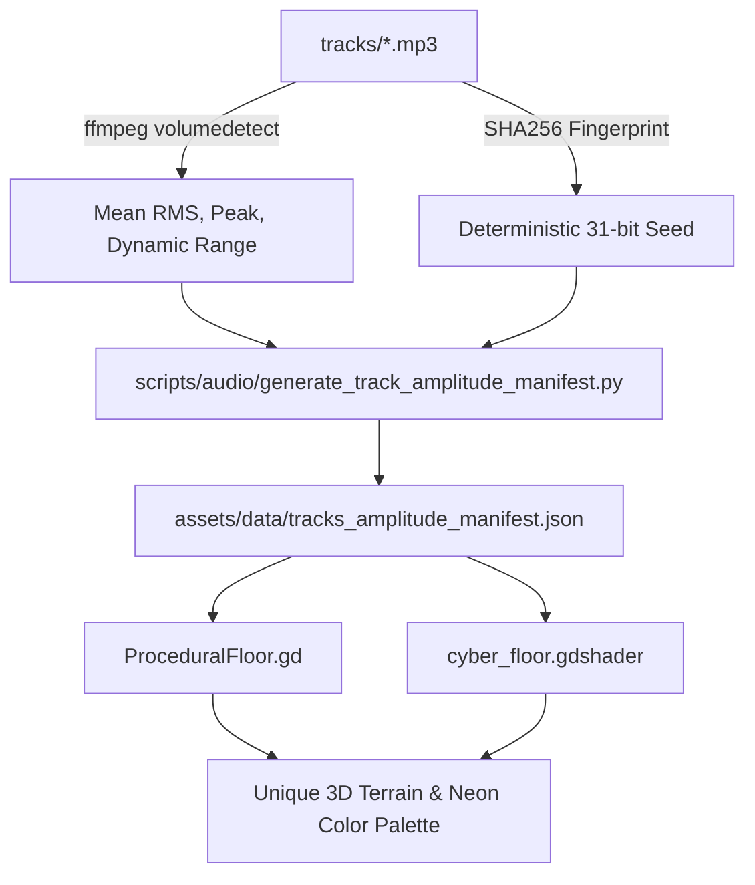

# Ninja Survivor

[](https://godotengine.org)
[](https://github.com/godot-jolt/godot-jolt)
[](#technical-architecture)
[](LICENSE#1-source-code-license-mit-license)
[](LICENSE#2-creative-audio--3d-model-assets-cc-by-nc-40)
[](https://www.macron1.io)

A fast-paced 3D synthwave roguelite survivor built in **Godot 4.7**, featuring audio-driven procedural terrain generation, stylized cyberpunk shaders, Jolt 3D physics, and Japanese cyber-mythology enemies.

---

## Technical Architecture

Ninja Survivor is structured around decoupled autoload managers, node-composition gameplay entities, and procedural audio/visual pipelines.

```
ninja-survivor/
├── assets/
│   ├── data/                 # Generated track metadata (tracks_amplitude_manifest.json)
│   └── models/               # 3D glTF models and procedural generation scripts
├── scenes/
│   ├── game/                 # Main GameArena and environment root
│   ├── menu/                 # MainMenu, LevelSelect, HighScores
│   ├── player/               # Player CharacterBody3D and camera rigs
│   └── ui/                   # HUD, LevelUp, Pause, GameOver, Victory screens
├── scripts/
│   ├── audio/                # Offline audio feature extraction scripts (Python)
│   ├── autoload/             # Global singletons (GameManager, AudioManager)
│   ├── enemies/              # BaseEnemy, AI state machine, EnemySpawner waves
│   ├── environment/          # Procedural floor chunking and displacement
│   ├── pickups/              # Datacubes, crystal XP orbs
│   ├── player/               # Movement physics, dashing, stats, inventory
│   ├── ui/                   # UI controllers and dynamic theming helpers
│   └── weapons/              # WeaponBase, projectiles, orbiters, area effects
├── shaders/                  # Custom Godot Shading Language (spatial & canvas)
├── tests/                    # Headless integration and verification test suite
└── tracks/                   # Soundtrack library (72 MP3 tracks)
```

### Core Singletons
- **`GameManager`** (`scripts/autoload/GameManager.gd`):
  - Manages run state, progression, and high scores.
  - Persists data to `user://ninja_save.json` (unlocked tracks, kill counts, survival times).
  - Handles track metadata ingestion from `tracks_amplitude_manifest.json`.
- **`AudioManager`** (`scripts/autoload/AudioManager.gd`):
  - Manages dedicated audio buses (`Master`, `Music`, `SFX`).
  - Implements a pre-allocated `AudioStreamPlayer` pool (size: 12) for polyphonic sound effects without runtime node allocation spikes.

---

## Audio-Driven Procedural Generation

Each level in Ninja Survivor corresponds to a soundtrack in `tracks/`. Levels feature unique, deterministic terrain and visual aesthetics dynamically derived from the music file's waveform.



### 1. Audio Feature Extraction
The offline analysis script [`scripts/audio/generate_track_amplitude_manifest.py`](scripts/audio/generate_track_amplitude_manifest.py) extracts volume statistics using `ffmpeg volumedetect`:
- **Mean RMS Volume & Peak Volume**: Used to calculate dynamic range and normalized energy `[0.0, 1.0]`.
- **Waveform Hashing**: Samples file header, midpoint, and volume metrics into a SHA-256 digest to derive a deterministic 31-bit integer seed.
- **Palette & Terrain Parameters**: Maps the seed and energy into terrain height variability (clamped $1.4\text{m} - 2.3\text{m}$), Voronoi cell frequency, and one of six curated neon synthwave color themes (e.g., *Neon Cyan & Magenta*, *Solar Crimson & Gold*, *Electric Violet & Teal*).

To regenerate the manifest after adding tracks:
```bash
python3 scripts/audio/generate_track_amplitude_manifest.py
```

### 2. Terrain Shaders & Physics
- **[`shaders/cyber_floor.gdshader`](shaders/cyber_floor.gdshader)**: Computes vertex displacement in real time using layered sinusoidal noise and Voronoi cellular textures, dynamically colored by the active track's primary, secondary, and ambient uniforms.
- **[`scripts/environment/ProceduralFloor.gd`](scripts/environment/ProceduralFloor.gd)**: Manages collision mesh alignment with Jolt Physics to ensure smooth player and enemy navigation across displaced surfaces.

---

## Procedural 3D Assets

Custom weapons and pickup crystals are generated using Blender's Python API via [`assets/models/generate_models.py`](assets/models/generate_models.py):
- **Razor Shuriken** (`weapon_shuriken_razor.glb`): Procedural 4-point concave star with beveled cutting edges, center bore, and emissive neon edge loops.
- **Datacube Crystal** (`pickup_datacube_crystal.glb`): Octahedral gem geometry with dual-pyramid apexes and custom PBR emissive materials.

---

## Development Setup

### Prerequisites
- **Godot Engine 4.7+** (Official build with .NET or standard GDScript support).
- **Godot Jolt Physics** enabled in project settings.
- **Python 3.10+** and **FFmpeg** (optional; required only if analyzing new audio tracks).

### Running from the Godot Editor
1. Clone the repository:
   ```bash
   git clone https://github.com/leouofa/ninja-survivor.git
   cd ninja-survivor
   ```
2. Open Godot Engine and choose **Import**.
3. Select `project.godot` inside the cloned directory and press **Import & Edit**.
4. Press **F5** (or the Play button) to run the main scene (`scenes/menu/MainMenu.tscn`).

### Running from the Command Line
```bash
# macOS
/Applications/Godot.app/Contents/MacOS/Godot --path .

# Linux
godot --path .

# Windows
godot.exe --path .
```

### Default Controls
| Action | Keybinding |
| :--- | :--- |
| **Move Up / Down / Left / Right** | `W` / `S` / `A` / `D` or Arrow Keys |
| **Dash (Invulnerability Frame)** | `Space` or `Shift` |
| **Pause Menu** | `Escape` or `P` |

---

## Automated Testing

Ninja Survivor includes an automated test runner for validating weapons, projectile ribbon trails, blade blur mechanics, and tiered datacube pickup states.

Run tests headlessly from the terminal:
```bash
godot --headless --path . tests/TestRunner.tscn --quit
```

Expected output confirms instantiation and runtime parameters for all test cases:
```text
--- BEGIN TEST: Datacube & Shuriken Visuals ---
✓ Shuriken & BladeBlur created successfully
✓ Shuriken ribbon trail running with 1 points
✓ Standard Emerald Datacube verified
✓ Elite Gold Datacube verified
```

---

## Contributing

Contributions are welcome! Please follow these basic guidelines:

1. **Fork & Branch**: Create a feature branch from `main` (`feature/my-enhancement`).
2. **GDScript Style**: Follow standard Godot GDScript style conventions (static typing where feasible, snake_case functions/variables, PascalCase class/node names).
3. **Verify Tests**: Ensure headless tests pass before opening a Pull Request.
4. **Open a PR**: Submit a Pull Request describing your changes, with screenshots or recordings for visual and UI updates.

For bug reports or feature requests, feel free to open a [GitHub Issue](https://github.com/leouofa/ninja-survivor/issues).

---

## License & Credits

- **Project Creator & Author**: **Leonid Medovyy** ([www.macron1.io](https://www.macron1.io))
- **Source Code**: Licensed under the **[MIT License](LICENSE#1-source-code-license-mit-license)**.
- **Soundtrack & 3D Assets**: All audio tracks in `tracks/` and 3D models in `assets/models/` are licensed under **[Creative Commons Attribution-NonCommercial 4.0 International (CC BY-NC 4.0)](LICENSE#2-creative-audio--3d-model-assets-cc-by-nc-40)**.
